# BrizSey RC1 🌤️🏝️
> **Fluid Glassmorphic Meteorological & Marine Intelligence for the Seychelles Archipelago**  
> Powered by live observations from the **Seychelles Meteorological Authority (SMA)** at [meteo.sc](https://www.meteo.sc) and high-resolution ASTER 30m Digital Elevation Model physics.

[-00E5FF.svg)](builds/BrizSey-2026-11-08-v1.2.0-b45-public.apk)

[-orange.svg)](https://developer.android.com)

---

## 📥 Direct APK Downloads & Release History

| Build | File Name | Size | Date | Download |
| :--- | :--- | :--- | :--- | :--- |
| **Build #45** 🌟 *(Latest)* | `BrizSey-2026-11-08-v1.2.0-b45-public.apk` | 3.4 MB | 2026-11-08 | [📥 Download](builds/BrizSey-2026-11-08-v1.2.0-b45-public.apk) |
| **Build #44** | `BrizSey-2026-11-08-v1.2.0-b44-public.apk` | 3.38 MB | 2026-11-08 | [📥 Download](builds/BrizSey-2026-11-08-v1.2.0-b44-public.apk) |

> 📱 **How to install**: Download the latest `.apk` file to your Android phone, tap the file in your Downloads folder, and select **Install** (allow "Install unknown apps" for your browser or file manager if prompted). On your launcher and home screen, the public release candidate appears as **BrizSeyRC1**.

---

## 📸 Application Showcase (Build #45)

| 🛰️ Live Nowcasting & GPS | 🌀 SWIO Cyclone Tracker | 🏔️ 30m DEM Microclimates |
| :---: | :---: | :---: |
| 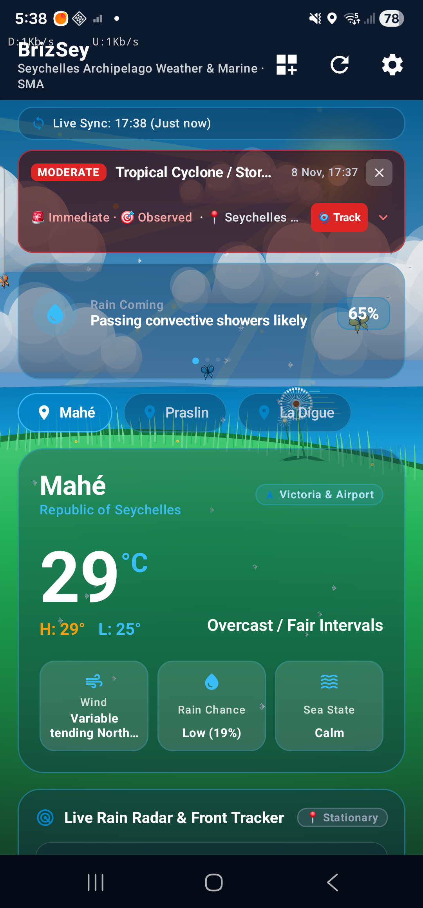 | 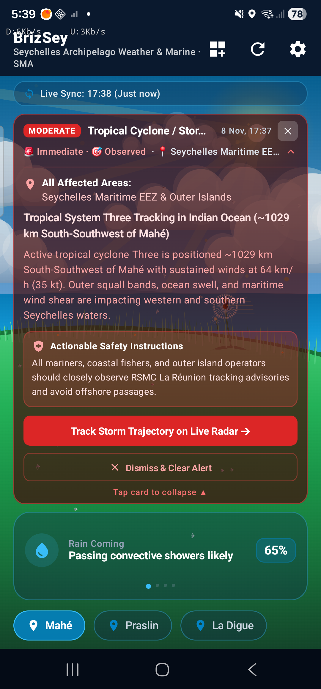 | 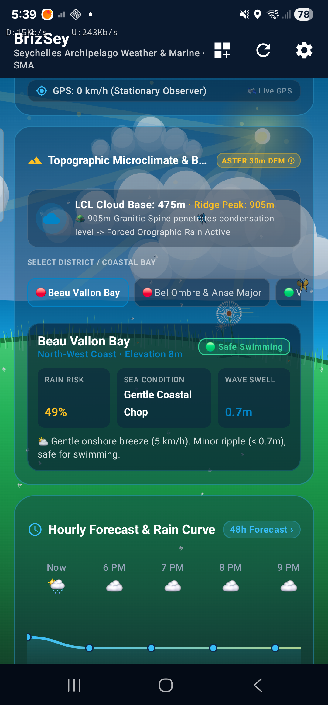 |
| **GPS Kinematics & 15s Ticker** | **RSMC/JTWC Trajectory & Range** | **ASTER 30m Ridge & Calm Bays** |

| 📈 Continuous Diurnal Curves | 🌊 Marine Swells & Tides | 📅 7-Day Synoptic Forecast |
| :---: | :---: | :---: |
| 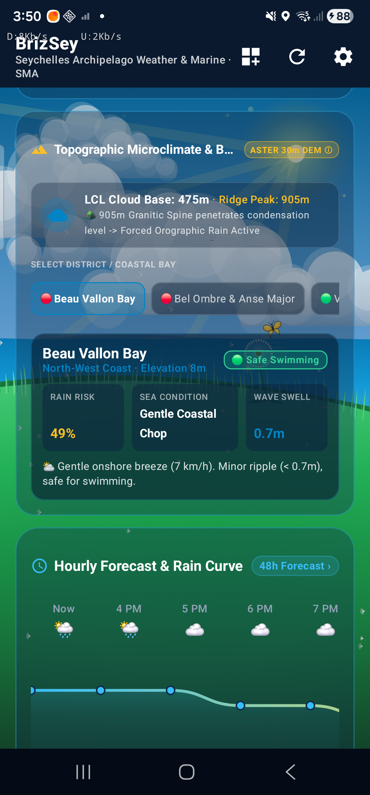 | 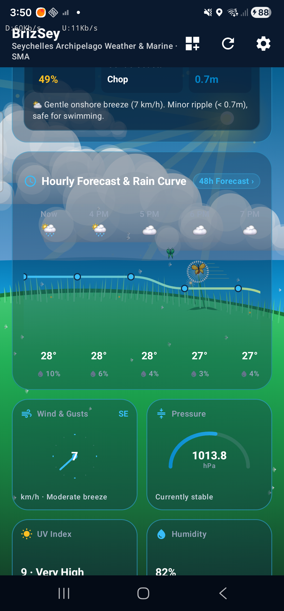 | 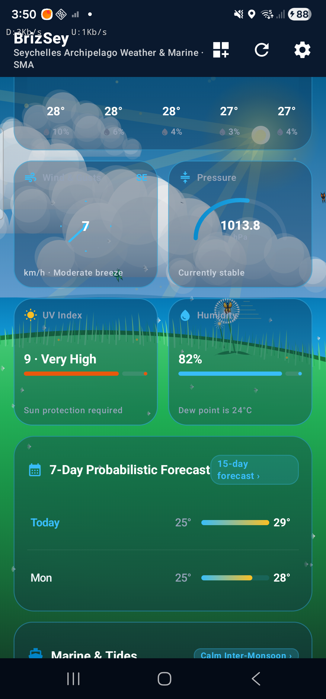 |
| **24h Curves & LCL Cloud Base** | **Victoria Tides & Monsoonal Swell** | **SMA 7-Day Official Forecast** |

| 🗺️ WebGIS Radar Map | ⚙️ Settings & Personas | ⚖️ Authorship & Legal Notice |
| :---: | :---: | :---: |
| 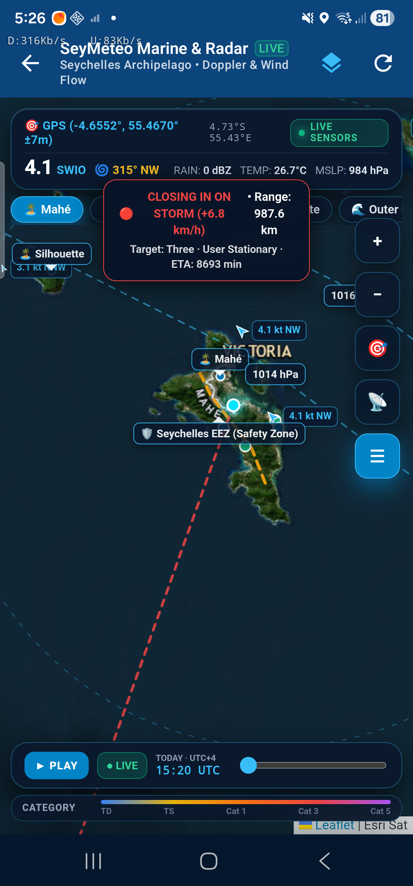 | 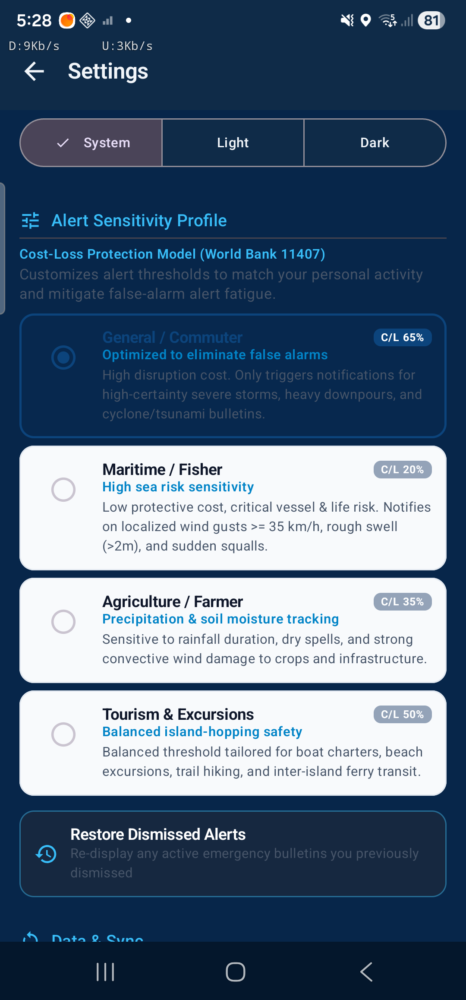 | 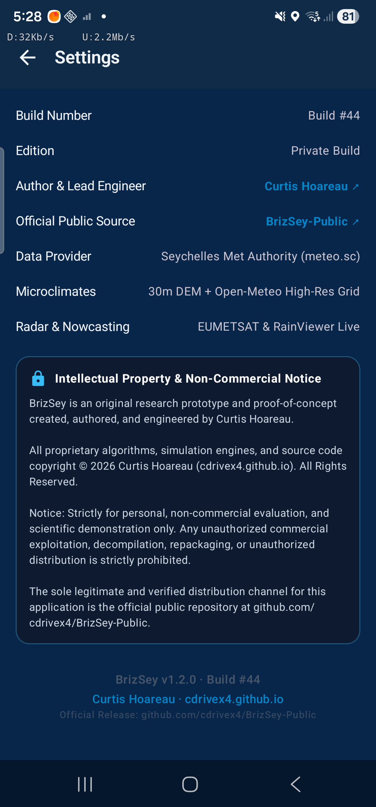 |
| **GPS Centering & Relative Storm Vector** | **World Bank 11407 Personas** | **Curtis Hoareau IP & Public Conduit** |

| 🌀 Regional Cyclone Trajectory (SWIO) | 🧭 High-Zoom Mahé Interception Vector |
| :---: | :---: |
| 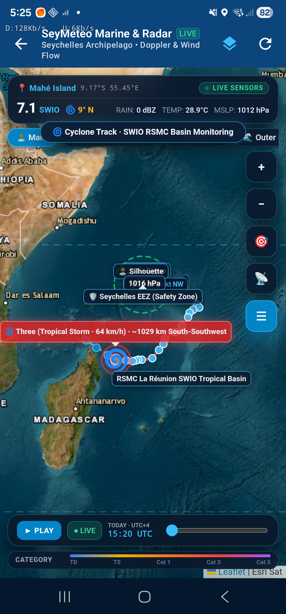 | 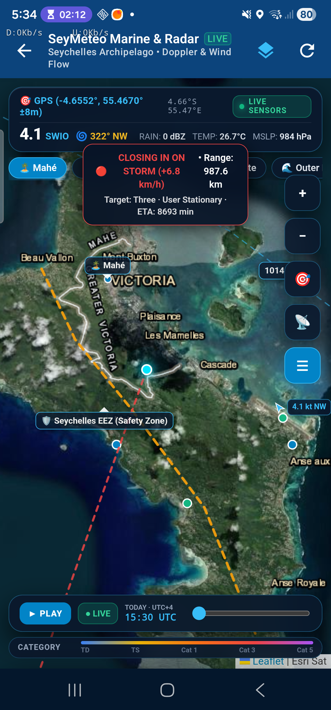 |
| **RSMC La Réunion Basin Tracking & Forecast Cone** | **Granular User GPS Fix & Dynamic Vector Telemetry** |

---

## ✨ Key Features & Capabilities

- **Official Live SMA Meteorological Observation**: Real-time synoptic stations at Mahé (Victoria & International Airport), Praslin, and La Digue.
- **Topographic Microclimate & Beach Calmness Guide (DEM 30m)**: Sub-kilometer terrain simulation using embedded ASTER 30m elevation grids to calculate leeward rain shadows, windward orographic lift, and coastal bay calmness across 14 individual Seychellois beaches.
- **SWIO Tropical Cyclone & Storm Tracker**: Real-time tracking of South-West Indian Ocean tropical depressions, storms, and cyclones sourced from RSMC La Réunion and JTWC, complete with category badges, central pressure, peak wind gusts, and multi-day forecast cones.
- **Lifting Condensation Level (LCL) Cloud Base Solver**: Real-time thermodynamic boundary layer modeling comparing cloud condensation ceilings against Mahé's 905m Morne Seychellois mountain spine.
- **Next-Gen Meteorological WebGIS & Live Doppler Radar**: Interactive timeline scrubbing across RainViewer radar, EUMETSAT satellite imagery, wave swell models, and dynamic particle vectors.
- **Dynamic 3-Layer Scenic Living Atmospheric Canvas**: 
  - *Layer 1*: Volumetric sky with sunbeams, radiant sun/moon, twinkling night stars, and procedural cloud banks.
  - *Layer 2*: Granitic island horizon with turquoise ocean waves and specular sun/moonlight reflections.
  - *Layer 3*: Emerald coastal bluff with wind-responsive grass blades, a living dandelion clock flexing in the breeze, drifting seed pappi, and a sunny-day Seychelles Citrus Swallowtail butterfly flight animation.
  - *Layer 4*: Dynamic glass condensation and water droplets sliding down the screen during precipitation.
- **Marine & Tidal Harmonic Predictions**: Spring/Neap tidal cycles, high/low tide schedules for Victoria Port, swell heights, and trade wind monsoons (*Vents Alizés* SE trade winds vs. NW monsoon).
- **Decision-Theoretic Cost-Loss Alerting Engine**: Four distinct user personas (Maritime/Fisher, Farmer, Tourism/Excursions, General Citizen) grounded in World Bank SIDS decision theory to protect high-risk marine actors while completely eliminating false-alarm notification fatigue.
- **Effortless Home Section Customization**: 1-tap Move Up (▲) / Move Down (▼) buttons and drag handles (`⠿`) with live persistent reordering.
- **Offline-First Resilience**: All forecasts, radar frames, and alerts are cached locally in SQLite/Room so the application launches instantly with zero network latency.

---

## 🐛 Bug Reports, Feedback & Community Inquiries

Community feedback and bug reports are managed directly via GitHub:
- 🐞 **Found a bug or issue?** Please open a ticket on our [GitHub Issue Tracker](https://github.com/cdrivex4/BrizSey-release/issues).
- 💬 **District Weather Reports**: When reporting forecast discrepancies, please specify your district, island, and approximate observation time.
- 📋 **Feature Requests**: Share suggestions for marine spots, additional beaches, or widget preferences on GitHub Discussions or Issues.

---

## 🔒 Source Code & Distribution Notice

The underlying source code of BrizSey is maintained in a private development repository. This public distribution repository provides verified release candidate APK binaries, showcase imagery, changelogs, and community issue tracking.

---

## 📜 Copyright & Attribution

`Copyright © 2026 Curtis Hoareau (https://cdrivex4.github.io/). All Rights Reserved.`  
Meteorological observations and official forecast bulletins provided under fair use by the [Seychelles Meteorological Authority (SMA)](https://meteo.sc) and [Open-Meteo](https://open-meteo.com).  
Notice: Strictly for personal, non-commercial evaluation, and scientific demonstration only.
